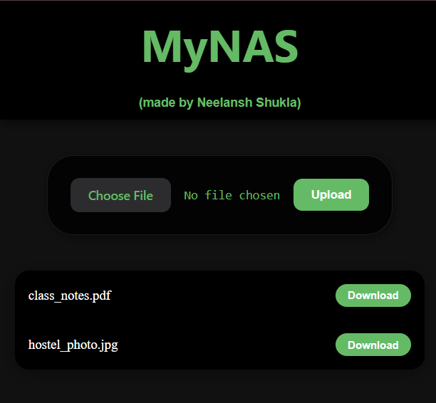

# MyNAS - ESP32 Micro NAS

A custom, web interface designed to manage file uploads and downloads for a local Micro NAS (Network Attached Storage) running on an ESP32 microcontroller.

This project aims to turn a low-power ESP32 microcontroller into a fully functional local file server.

# Tech Stack

- **Frontend:** HTML5, CSS3 , Vanilla JavaScript.
- **Backend:** C++ (Arduino IDE), `ESPAsyncWebServer`, `SD.h` library.
- **Hardware:** ESP32, Micro SD Card Module, 8GB SD card, bread-board, jumper-wires.
